> **This game is an early demo.** The rules in this book —
> cards, battles, quests, gems — are real. The specific
> people, places and numbers are examples from the demo
> and will grow and change as the land fills in.

# The Story

Once the land was quiet. Then the **slimes** came.

They oozed out of the marshes, chewed through the
hedgerows, and settled in like they owned the place.
Now the roads crawl with bats, spiders and worse, and
the settlements have learned to keep their doors shut
and their opinions to themselves.

You are the hero who woke up in **Wake Grove** with a
handful of cards and no good excuse to stay home. Your
cards are your courage: every fight in this land is a
card duel, and a well-played hand beats a sharp sword
any day of the week.

The folk of the **human settlement** to the east will
ask for your help — in this demo, a merchant wants
his family heirloom back, and the Mayor wants monsters
dealt with. And far to the north, behind the old castle
walls, something is waiting in the throne room that has
been waiting a very long time.

Its name is the **Lord of Slimes**. That is where the
demo's road ends — for now. More of the land, and more
of its stories, is still to come.

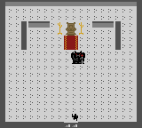

# Starting Out

Switch on your Game Boy. After the title screen, press
**START** and choose from the menu:

| Menu | What it does |
|---|---|
| **NEW GAME** | Begin a brand-new adventure. |
| **CONTINUE** | Load a game you saved earlier. |
| **SOUND: ON/OFF** | Turn the music on or off. |
| **TUTORIAL** | A short how-to-play lesson. |
| **CREDITS** | The people who made this. |

> **First time?** Play the **TUTORIAL** slides before
> you start. Use LEFT and RIGHT to turn the pages and
> **B** to leave.

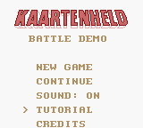

# Controls

| Button | Walking around | In battle |
|---|---|---|
| **D-Pad** | Walk | Move the hand cursor |
| **A** | Talk, read, open | Pick a card |
| **B** | Cancel | Undo pick; flee from the menu |
| **START** | Open your card screen | Open your card screen |
| **SELECT** | Load a saved game | Play the cards you picked |

Inside any menu, **UP** and **DOWN** move the pointer,
**LEFT** and **RIGHT** change pages, **A** chooses and
**B** backs out.

# Walking the World

The land is a wide map of little squares. Walk to the
edge of a map and step on a gate arrow (`>` or `<`) to
travel to the next place. Towns have gates; wild places
have paths; the castle has a big front door.

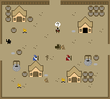

Stand in front of a person and press **A** to talk.
Some of them have something to say, and some of them
have something to *give*.

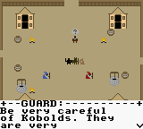

- **Signposts** teach you things. Read every one.
- **Helpers** — a guard, a knight, a healer — share hints.
- **Monsters** wander the wilds. Touch one and a battle
  begins. There is no running past a slime.

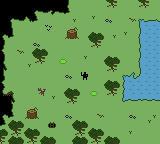

# Your Hero

Your hero is a simple sort:

- **15 health points** (HP) to start. When they are gone,
  the adventure is over.
- **20 gold** in the purse.
- A **starter deck of 12 cards**.
- **1 energy** (AP) for each decision, attack and
  defence.

Three things keep the hero going: the **Heal Mage**
restores all your HP for free, the **Wizard** saves your
progress, and the **monsters** drop cards. Visit them all
more often than you think you need to.

## Your quests

The **QUEST** tab lists every promise you have made.
Quests are how the land asks for help, and the demo
holds the first few examples:

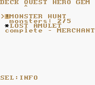

- **A monster hunt.** The Mayor pays for dead
  monsters — an early example of a hunt quest, and one
  that teaches the value of a finished promise.
- **A lost heirloom.** The Merchant's family keepsake
  was stolen by bandits in the northern mountains.
  Bring it home and his shop opens — an early example
  of a fetch quest with a real reward.
- **The castle.** Something in the throne room has
  been waiting a very long time. That is the demo's
  last promise, and its biggest one. The full game
  will hold many more.

# Your Cards

Everything you need to win is written on a card. A card
shows:

- its **name** and its **material** (wood, bronze, iron,
  steel or mythril),
- a **type symbol** — `SW`, `SH`, `BO`, `DA` or `RG`,
- a **power** number, used for damage, blocking or healing,
- an **energy cost** (small pips in the corner), and
- sometimes a **rider**: fire, poison or ice.

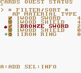

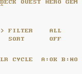

## The five kinds of cards

| Card | Attack | Defend |
|---|---|---|
| **Sword** `SW` | Damage | Nothing |
| **Bow** `BO` | Damage | Nothing |
| **Dagger** `DA` | Damage, may poison | Counterattacks alone (no shields/swords/bows); lost mixed |
| **Shield** `SH` | 0 damage, but counts for combos | **Blocks** |
| **Ring** `RG` | Converts the hand to healing | 0 block, but wildcard |

> The in-game tutorial calls the ring `HE` for **heal**.
> It is the same card: `RG` on the card itself, `HE` in
> the lesson.

**Swords, bows and daggers are your attack.** A shield
deals no damage on your turn — but it still counts as a
card when you build a poker hand, which is often worth
more than the damage you gave up.

**Rings are your healing.** They never hurt anybody.
Played with an attack, the whole hand turns into a heal
instead of a hit. Played on defence, a ring acts as any
value you need to finish a combo — but blocks nothing
itself.

## Riders

A rider is an extra effect bolted onto a card:

- **Fire** cards add **burn** — 1 damage a round.
- **Poison** cards add **poison** — 1 damage a round
  until the fight ends.
- **Ice** cards can **freeze**, and a frozen fighter
  misses their whole turn.

Wood cards are always plain. Riders start at bronze.

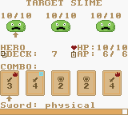

## Collection, deck and copies

The cards you **own** are your **collection**, up to 12
different cards. The cards you **bring to battle** are
your **deck**, up to 20 cards.

Open the card screen with **START**. The **DECK** tab
lists everything you own; press **A** on a card to put
one copy into your deck. Once every copy is decked, the
next **A** takes them all out again. **SELECT** opens the
card's details, and the **FILTER/SORT** row at the top
of the list lets you find a card quickly.

> **Your deck cannot go below 5 cards.** You need a full
> hand to fight.

# A Battle Begins

Touch a monster and the battlefield appears. Most
fights are against a **trio** of the same monster.
Bosses fight alone, on their own wide screen.

The top of the screen shows the monsters and their
health. The bottom shows you, your deck, your energy
and your hand of five cards.

## One round, step by step

1. **Play your attack.** Pick up to five cards, then
   press **SELECT**.
2. **Watch it land.** Your combo deals damage or heals
   you.
3. **The monster shows its card.** That card's value is
   the damage coming at you.
4. **Defend.** Play shields to block it and press
   **SELECT**.
5. **Resolve, refill, next round.**

You always strike first. Keep going until the monsters
— or you — run out of health.

## Your hand and your energy

You draw **five cards**. Energy (AP) is what you spend
to play them: **1 AP** at first, refreshed for the
attack *and* again for the defence every single round.

You can raise your AP for good. The demo hides
several upgrades — a practice spar, a treasure chest,
a finished quest, a castle fight — each worth +1 AP
a round, up to **5 AP** in total. Find them all and
you will play every round at full energy.

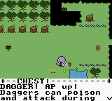

## The timer

The bar at the bottom of the screen is a **20 second**
clock. When it empties, whatever you have picked is
played for you. It never runs during animations, so
read the card descriptions and decide.

## Attacking

Cards you pick are ranked **like a poker hand**. The
better the hand, the harder the whole play hits.

Only the cards that *make* the hand count. A stray card
adds nothing but still costs energy. `SW1 SW1 SW2` is a
pair of ones: it hits for 2, and the `SW2` is wasted.

The **first card you pick** decides what the play does:

- Lead with a **sword, bow or dagger** and you deal
  damage.
- Have a **ring** anywhere in the hand and the whole
  play heals you instead. There is no way to deal
  damage and heal at the same time.
- Lead with a **shield** and you still deal the damage
  of the other cards; shields are harmless but they
  count for the combo.

## Combos: play poker!

| Hand | You have | Bonus |
|---|---|---|
| High card | anything | 100% |
| Pair | two of a value | 120% |
| Two pair | two pairs | 150% |
| Three of a kind | three of a value | 180% |
| Straight | five in a row | 210% |
| Flush | five of one type | 240% |
| Full house | three plus a pair | 260% |
| Four of a kind | four of a value | 280% |
| Straight flush | a straight, one type | 350% |
| Five of a kind | five of a value | 400% |

Five cards of the **same type** get an extra **+25%** on
top, so five swords in a row hit harder than five mixed
cards.

> With the **STRAIGHT GEM** equipped, three cards in a
> row also score. See **Gems**.

The **COMBO** row above your hand previews the tier and
the damage as you pick, before you commit. Trust it.

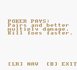

**Example:** `SW2 + SW2` is a pair. Base 4, times 120%,
hits for **4**. Add a third `SW2` and it is three of a
kind: base 6, times 180%, hits for **10**.

## Defending

When the monster telegraphs its card, its value is the
damage heading your way. **Only shields block.**

Damage you take is the incoming value minus the block
from the shields in your poker hand. Shields outside
the hand block nothing: `SH2 + SH2 + SH5` is a pair of
twos and blocks 4; the `SH5` is wasted.

If your block beats the incoming damage, you take
nothing — and if a **ring** is in the hand, the
over-block heals you instead.

## Status effects

| Status | What it does |
|---|---|
| **Poison** | 1 HP a round, greys out two of your cards |
| **Burn** | 1 HP a round |
| **Freeze** | You miss your whole turn |

Greyed cards cannot be picked until the poison wears
off. A frozen hero skips both the attack and the block,
so a freeze at the wrong moment really hurts.

## Running out of cards

Every card has a number of **uses** per battle. A spent
card stays in your deck but cannot be played
(`OUT OF USES!`).

When the draw pile runs dry, the discards are
reshuffled into it — and that round is spent doing it.
The monster still attacks, so keep a shield spare.

## Winning, losing, running

- **Victory:** every monster down. You earn gold, and
  the monster drops exactly **one card**. You choose
  whether to keep it, deck it, or sell it later.
- **Defeat:** your HP reaches zero. The **GAME OVER**
  screen sends you back to the title screen, where you
  can load a save — or you can stop for the day.
- **Flee:** press **B** with nothing selected during
  your attack. No reward, and the monster lives. You
  cannot flee from a defence.

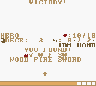

# Gold, Shops and Loot

Battles pay in **gold** — in the demo, a slime is
worth 5, a bat or a kobold 8, a spider 15. Exact
rewards will vary as the game grows, but the rule
holds: fighting pays, and the purse fills.

Shops open as you help people. For example, the
**Merchant** opens his shop once you bring back his
stolen heirloom from the north. In the demo he sells
two things worth having:

- an **Iron Ring** for 20 gold — your first reliable heal,
- the **Mythril Bow** for 30 gold — the hardest single
  hit in the game.

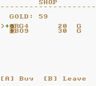

On the shop screen **A** buys and **B** leaves. Press
**SELECT** to switch to **SELL** mode, then pick a card
to turn it into gold. Every monster drops cards, so you
will always have something to sell.

> Cards are graded by material. Wood is common, bronze
> and iron are solid, steel is rare and mythril is the
> stuff of legend. Better materials drop once your AP
> is higher.

# Gems

Gems are **passive skills**. They are small, permanent
and a little strange: owning one does nothing at all.
You have to **equip** it.

## The GEM tab

Open the card screen with **START**, then move across
to the **GEM** tab. Every gem you own is listed with its
skill underneath its name.

- **A** switches a gem **ON** or **OFF**.
- **SELECT** opens the INFO page and explains the rules.
- You may equip at most **3 gems** at once.

An equipped gem changes the battle rules themselves,
which makes gems the strongest thing you can carry. A
gem you own but have not equipped is just a souvenir.

## An example: the Straight Gem

The first gem in the demo is the **STRAIGHT
GEM**. Its skill is **SHORT STRAIGHT**.

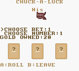

- **Three cards in a row** now count as a combo:
  `SW3 DA4 SW5` scores at **130%**, slotted just above
  two pair.
- With a run of four, only the **best three** count.
  A second copy of a value scores nothing.
- **Rings fill the gaps**, because a ring can stand in
  for any value.
- With the gem off, the tier does not exist at all: a
  pair stays a pair and a high card stays a high card.

## How to win a gem (in the demo)

You win it from **Nis**, a friendly kobold who runs a
**chuck-a-luck** table in the village. Leave the table
**20 gold or more up in one sitting** and he hands it
over — once, and only once. Minigames like this are
one more way the land rewards a hero; the full game
will hold more of them.

## Playing chuck-a-luck

Nis's table is an early example of the minigames
planned for the game.

Nis rolls three dice. You pick a number from 1 to 6 and
a bet of 1, 5 or 10 gold.

| Dice that match | You win |
|---|---|
| none | you lose the bet |
| one | 1:1 — the bet back plus the bet |
| two | 2:1 — the bet back plus double |
| three | 3:1 — the bet back plus triple |

**UP** and **DOWN** switch between the number and the
bet. **LEFT** and **RIGHT** change the value. **A**
rolls. **B** leaves the table — and that is when your
sitting is counted.

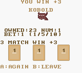

> A steady small bet is how a hero walks away up 20.
> Chasing a triple with big gold is how a hero walks
> away with a story about the time they almost won.

# Saving and Loading

Find the **Wizard** in the settlement. He saves your
adventure into one of **three slots**.

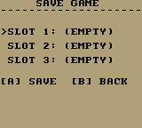

Choose a slot and press **A**. Your Game Boy remembers
even after you switch it off, so you can always come
back later.

To load, press **SELECT** while walking around, or pick
**CONTINUE** on the title screen. Saving in a slot
overwrites what was there before — pick a different
slot if you want to keep an old adventure.

# Winning the Demo

Defeat the **Lord of Slimes** in the castle's throne
room and the demo is complete. You will see the ending,
and everyone you met will have something to say about
it. The full game will carry the road further.

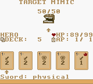

If your hero falls, the **GAME OVER** screen asks:

- **YES** — return to the title screen and load a save.
- **NO** — put the Game Boy down and think about what
  you would do differently.

# Tips and Tricks

- **Read the signposts.** They are honest, which is rare.
- **Only shields block.** Save them for the defence.
- **Shields still score.** A shield in your attack hand
  makes the combo bigger even though it deals nothing.
- **Rings are flexible.** Use one to finish a straight or
  a pair, or keep it for a heal.
- **Pick the lead card first.** It decides whether the
  play attacks or heals.
- **Watch your AP.** A bigger hand is not always a
  better hand when the extras score nothing.
- **Raise your AP early.** The demo hides several
  upgrades — spar, chest, quest, castle fight.
- **Visit the Heal Mage.** Free healing, no questions.
- **Sell cards you cannot use** and buy a good heal.
- **Save often.** You never know what is around the next
  corner, and now you can check.

# Quick Reference

| | |
|:--|--:|
| Starting HP | 15 |
| Starting gold | 20 |
| Starting AP | 1 per phase |
| Maximum AP | 5 per phase |
| Cards in hand | 5 |
| Starting deck | 12 cards |
| Deck limit | 20 cards |
| Collection limit | 12 different cards |
| Decision timer | 20 seconds |
| Gems equipped | 3 at most |
| Save slots | 3 |
| Demo goal | Help the settlement, then head north |

Now go, hero — the cards are in your hands.

# Precautions

- Please take a short rest, ten to fifteen minutes
  every hour, however engrossing the slimes are.
- Stop playing and consult a grown-up if your hands or
  eyes start to hurt.
- Do not play in a moving vehicle. The road monsters
  are real.
- Wipe the cartridge with a dry cloth. Do not lick it,
  no matter what the kobold says.
- Save your game before switching off. The Wizard is
  good, but he is not that good.

**This game is a work of fiction.** Any resemblance to
actual slimes, living or crystallised, is coincidental.
